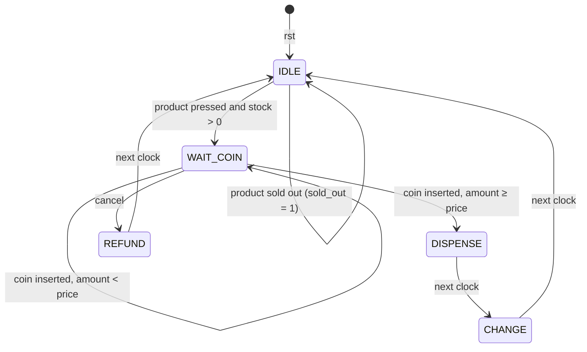

# 4. Finite State Machines (FSM)

## 4.1 The idea, with a daily-life example

Think of a **traffic light**. At any moment it is in exactly one of a few situations: RED, GREEN or YELLOW. After some time it **moves** to the next one, always in a fixed pattern.

- Each situation is called a **state**.
- Moving from one state to another is called a **transition**.
- The reason for moving (timer finished, button pressed…) is the **condition** or **input**.
- What the light shows in each state is the **output**.

Because there is a **limited (finite)** number of states, we call this a **Finite State Machine**.

## 4.2 Why a vending machine is an FSM

A vending machine also goes through fixed steps:

1. Waiting for someone to choose a product
2. Waiting for enough money
3. Giving out the product
4. Giving back change
5. (or) Giving back all the money if the customer cancels

Each step is a **state**. The buttons and coins are the **inputs**. The product, change and refund are the **outputs**.

## 4.3 Parts of every FSM

An FSM in hardware has three parts (look back at the picture in [file 2, section 2.8](02-digital-basics.md#28-sequential-logic--memory--combinational-logic)):

```
               ┌──────────────────────┐
  inputs ────▶ │  NEXT-STATE LOGIC    │
          ┌──▶ │  (combinational)     │
          │    └──────────┬───────────┘
          │               │ next_state
          │        ┌──────▼──────┐
          │        │ STATE        │◀── clk, rst
          │        │ REGISTER     │
          │        │ (flip-flops) │
          │        └──────┬──────┘
          │               │ state
          └───────────────┤
                    ┌─────▼──────────┐
                    │ OUTPUT LOGIC   │ ───▶ outputs
                    │ (combinational)│
                    └────────────────┘
```

1. **State register** — flip-flops that store the current state.
2. **Next-state logic** — decides the next state from the current state + inputs.
3. **Output logic** — decides the outputs.

## 4.4 Moore vs Mealy

There are two kinds of FSM, depending on what the outputs depend on:

| | **Moore machine** | **Mealy machine** |
|---|---|---|
| Outputs depend on | **only the current state** | current state **and** current inputs |
| Output changes | only at clock edges (when state changes) | can change in the middle of a cycle when inputs change |
| Number of states | usually more | usually fewer |
| Glitches on output | fewer (safer) | can have glitches if inputs glitch |
| Speed of response | output comes 1 clock later | output can come in the same clock |

**Our vending machine is a Moore machine.** For example:

```verilog
assign dispense = (state == DISPENSE);   // depends only on state
```

`dispense` is 1 only while the machine is in the DISPENSE state — it does not look at any button or coin directly. This makes the outputs clean and stable for a whole clock cycle, which is safer for driving a motor that pushes the product out.

> Detail for the curious: `change = amount - price` also uses the `amount` and `price` registers. These are stored values (memory), not live inputs, so the output still changes only at clock edges — the Moore property is kept.

## 4.5 State diagram

A **state diagram** draws states as circles and transitions as arrows. Each arrow is labelled with the **condition** for taking it.

Our machine:



The same thing in plain text (in case Mermaid does not render):

```
                    product pressed & stock>0             amount ≥ price
     rst ─▶ ┌──────┐ ─────────────────────────▶ ┌───────────┐ ──────────▶ ┌──────────┐
            │ IDLE │                             │ WAIT_COIN │             │ DISPENSE │
            │ 000  │ ◀──────┐                    │    001    │             │   010    │
            └──────┘        │                    └───────────┘             └────┬─────┘
             ▲  ↺ sold out  │ next clk              │  ↺ coin,                  │ next clk
             │              │                       │    amount < price         ▼
             │          ┌───┴────┐       cancel     │                     ┌──────────┐
             │          │ REFUND │ ◀────────────────┘                     │  CHANGE  │
             │          │  100   │                                        │   011    │
             │          └────────┘                                        └────┬─────┘
             └─────────────────────────── next clk ────────────────────────────┘
```

(↺ means the machine stays in the same state.)

## 4.6 State table

A **state table** shows the same information as a table — very useful for writing the Verilog `case` statement.

| Current state | Condition (inputs) | Next state | What else happens |
|---|---|---|---|
| IDLE | no button | IDLE | — |
| IDLE | product pressed, stock = 0 | IDLE | `sold_out ← 1` |
| IDLE | product pressed, stock > 0 | WAIT_COIN | save item & price, `amount ← 0`, `sold_out ← 0` |
| WAIT_COIN | cancel | REFUND | — |
| WAIT_COIN | coin, new amount < price | WAIT_COIN | `amount ← amount + coin` |
| WAIT_COIN | coin, new amount ≥ price | DISPENSE | `amount ← amount + coin` |
| WAIT_COIN | nothing | WAIT_COIN | — |
| DISPENSE | (always) | CHANGE | `stock ← stock − 1`, `total_sales ← total_sales + price` |
| CHANGE | (always) | IDLE | `amount ← 0` |
| REFUND | (always) | IDLE | `amount ← 0` |

Outputs (Moore — depend only on state):

| State | dispense | change | refund |
|---|---|---|---|
| IDLE | 0 | 0 | 0 |
| WAIT_COIN | 0 | 0 | 0 |
| DISPENSE | **1** | 0 | 0 |
| CHANGE | 0 | **amount − price** | 0 |
| REFUND | 0 | 0 | **amount** |

## 4.7 State encoding

The hardware cannot store the word "IDLE"; it stores bits. We give each state a binary code. With 5 states we need **3 bits** (2 bits = only 4 codes, 3 bits = 8 codes).

| State | Code |
|---|---|
| IDLE | `000` |
| WAIT_COIN | `001` |
| DISPENSE | `010` |
| CHANGE | `011` |
| REFUND | `100` |

This is called **binary encoding** (states numbered 0, 1, 2…). Other choices exist:

| Encoding | Example for 5 states | Flip-flops | Note |
|---|---|---|---|
| **Binary** (ours) | 000, 001, 010, 011, 100 | 3 | fewest flip-flops |
| **One-hot** | 00001, 00010, 00100, 01000, 10000 | 5 | one bit per state; simpler, faster logic, popular on FPGAs |
| **Gray** | 000, 001, 011, 010, 110 | 3 | only one bit changes between neighbouring states |

Codes `101`, `110`, `111` are **unused states**. If the machine ever got into one (for example due to electrical noise), our `default: state <= IDLE;` line brings it back to IDLE. This makes the design **safe / self-recovering**.

## 4.8 Steps to design any FSM (the method we followed)

1. **Write the specification** — what should the machine do?
2. **List the inputs and outputs.**
3. **Find the states** — each "waiting" or "doing" step is a state.
4. **Draw the state diagram** with conditions on each arrow.
5. **Make the state table.**
6. **Choose Moore or Mealy** and the **state encoding**.
7. **Write the Verilog** — one `case` branch per state.
8. **Write a testbench** and simulate every path in the diagram.

Next: [05 — Our vending machine design](05-vending-machine-design.md)
